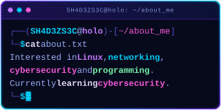
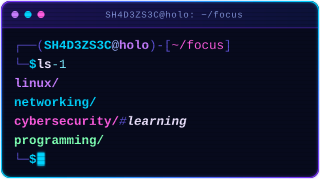

<!-- ============================================================
     SH4D3ZS3C // profile README  ·  hologram theme
     Palette: panel #070A1C · purple #7B2FF7/#C77DFF · cyan #00D4FF · text #9FB4FF
     Local files this README needs (all in /assets):
       banner.svg · avatar-hologram.svg · equalizer.svg · divider.svg
     ============================================================ -->

<table width="100%">
<tr>
<td width="62%" valign="top">

### `SH4D3ZS3C`

*Learning cybersecurity.* 
*Into Linux, networking & programming.*

`linux` `networking` `cybersecurity` `programming`

### `// about_me`

### `// current_focus`

</td>
<td width="38%" valign="top" align="center">

### `// stats`

### `// signal_scan`

### `// tcp_handshake`

</td>
</tr>
</table>

`// connection closed`  ·  <a href="https://github.com/SH4D3ZS3C">github.com/SH4D3ZS3C</a>  ·  <a href="https://github.com/SH4D3ZS3C?tab=repositories">repositories</a>

